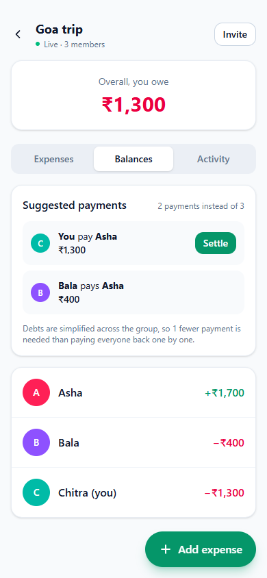
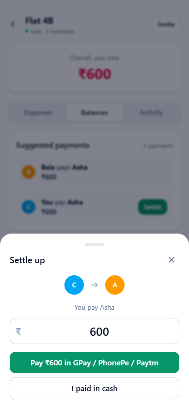
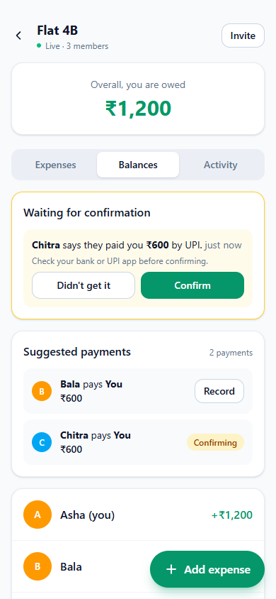
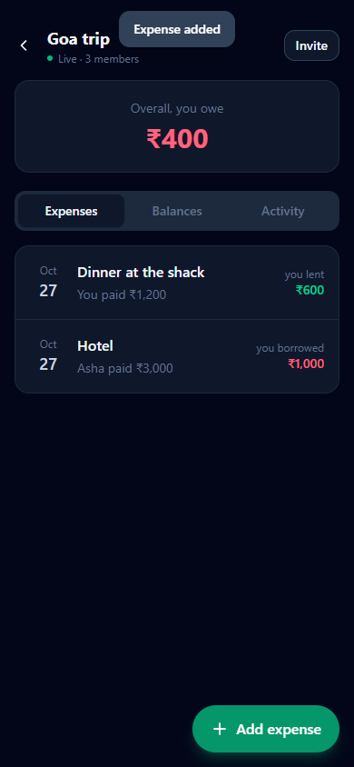
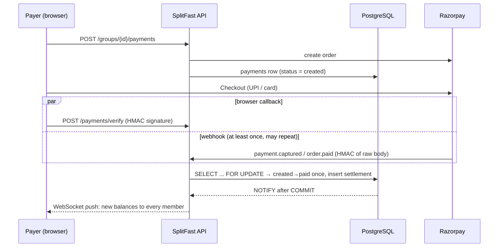

# SplitFast

Split expenses with friends, see who owes whom in real time, and settle up in the **fewest possible payments**: pay a friend directly through any UPI app (GPay, PhonePe, Paytm), pay through Razorpay, or record cash.

SplitFast is an installable PWA: it runs at a URL in any browser, and "Add to Home Screen" turns it into a full-screen app on Android and iOS.

<p>
  
  
  
  
</p>

**Stack:** FastAPI · PostgreSQL 16 (asyncpg) · WebSockets + LISTEN/NOTIFY · Razorpay Orders, Checkout and Webhooks · React 19 + TypeScript · TanStack Query · Tailwind 4 · vite-plugin-pwa · Docker · GitHub Actions

---

## What's interesting in here

### 1. Debt minimisation: exact where possible, greedy otherwise

[`backend/app/settle.py`](backend/app/settle.py)

Every member's net balance is computed from expenses and settlements (positive means they are owed). Any set of payments that zeroes all balances is valid; the goal is the smallest such set.

If the members can be split into **k** disjoint groups that each sum to zero, everyone settles in **n − k** payments, because a zero-sum group of size *m* needs exactly *m − 1*. So *minimise payments* is the same problem as *find the most zero-sum groups*. That problem is NP-hard (it contains subset-sum), so:

| Group size (non-zero balances) | Strategy | Guarantee |
|---|---|---|
| ≤ 14 | Bitmask DP over all subsets, O(2ⁿ·n), then greedy inside each zero-sum group | **Optimal** |
| > 14 | Greedy: repeatedly match the largest debtor with the largest creditor (two heaps) | ≤ n − 1 payments |

Pure greedy is not optimal. With balances `{a:−5, b:+5, c:−3, d:−4, e:+7}`, greedy makes 4 payments but the optimum is 3, because `{a,b}` and `{c,d,e}` settle separately. That case is a [test](backend/tests/test_settle.py). The UI shows the saving: *"2 payments instead of 3"*.

### 2. Money is integers, and Postgres enforces the books

- All amounts are **integer paise**; floats never touch money. Leftover paise from equal, percent and share splits go out by the **largest-remainder method** with a deterministic tie-break, so ₹100.01 ÷ 3 = 33.34 + 33.34 + 33.33. The frontend preview uses the same algorithm, so what you see is what's saved to the paisa.
- A **deferred constraint trigger** makes PostgreSQL reject any transaction in which an expense's shares don't sum to its amount. The rule holds even if a bug or a manual query bypasses the API ([`001_init.sql`](backend/migrations/001_init.sql)).
- Balances are never stored; they're derived with one SQL query, so there's no second copy to drift.

### 3. Idempotent payments: webhook + client callback, settled exactly once

[`backend/app/routers/payments.py`](backend/app/routers/payments.py)



A payment gets confirmed twice (browser callback and webhook), and Razorpay may redeliver the webhook. The design survives that:

1. **Event dedupe:** `webhook_events.event_id` is the primary key (from `x-razorpay-event-id`). The dedupe insert and the processing share **one transaction**, so if processing crashes, the dedupe row rolls back too and Razorpay's retry gets a clean attempt.
2. **Row lock + state machine:** both paths call `mark_paid()`, which takes `SELECT … FOR UPDATE` on the payment and only acts while `status = 'created'`.
3. **Constraint backstop:** `settlements.payment_id` is `UNIQUE`, so even a logic bug can't create two settlements for one payment.
4. **Integrity:** webhook signatures are checked against the **raw bytes** with a constant-time compare, and the captured amount must match the order amount.

Expenses and cash settlements are idempotent the same way: the client generates the UUID, so a retry after a dropped response returns `200` with the existing row instead of adding a duplicate.

The concurrency test ([`test_api.py`](backend/tests/test_api.py)) holds the first confirmation's transaction open while a second arrives. With the `FOR UPDATE` removed, the test fails. A naive "fire 30 requests at once" test passed even with the bug, so the test forces the exact interleaving instead.

### 4. Direct UPI payments, verified by the person who got the money

[`settlements` in `groups.py`](backend/app/routers/groups.py) · [`upi.ts`](frontend/src/lib/upi.ts)

Most debts between friends should go **straight to the friend** at no cost, not through a payment gateway. On a phone, **Settle** opens a `upi://pay` deep link with the friend's UPI ID and the amount filled in, so GPay, PhonePe or Paytm opens ready to pay. On a laptop it shows the same link as a **QR code**.

The catch: a UPI payment moves bank to bank, and nothing reports the result back to a web app. So the app never assumes a payment happened:

| Who records the payment | Status | Counts towards balances |
|---|---|---|
| Payer ("I paid via UPI / cash") | `pending` | No. The receiver gets a live **Confirm / Didn't get it** prompt |
| Receiver ("I received it") | `confirmed` | Yes, immediately; they are the one vouching for it |
| Razorpay (signed webhook) | `confirmed` | Yes. A database CHECK forbids a pending Razorpay settlement |

Confirm and reject are a single conditional `UPDATE … WHERE status = 'pending' AND to_user = <me>`. Only the receiver can move a claim, only once, and only out of `pending`. A double tap returns the same result, and confirming something already rejected returns `409`. Balance queries only read `confirmed` settlements.

### 5. Real-time updates that work across instances

[`backend/app/realtime.py`](backend/app/realtime.py)

Every write calls `pg_notify()` **inside** its transaction, so Postgres delivers the event only if the write commits. Clients never see a change that later rolled back. Each app instance `LISTEN`s on the channel and pushes a fresh balance snapshot to the sockets it holds. The result is horizontal scaling with no Redis. The client writes the snapshot straight into the TanStack Query cache and reconnects with exponential backoff.

---

## Run it

### With Docker

```bash
cp .env.example .env        # optional: add Razorpay test keys
docker compose up --build   # http://localhost:8000
```

### Without Docker (development)

```bash
# backend
cd backend
python -m venv .venv && .venv/Scripts/activate      # macOS/Linux: source .venv/bin/activate
pip install -r requirements-dev.txt pgserver
python scripts/dev_db.py                             # embedded Postgres 16, prints DATABASE_URL
DATABASE_URL=<printed url> uvicorn app.main:app --reload --port 8000

# frontend (second terminal): http://localhost:5173, proxies /api and /ws to :8000
cd frontend && npm install && npm run dev
```

### Tests

```bash
cd backend
TEST_DATABASE_URL=<printed test url> pytest -q     # 27 tests; API tests skip without a database
```

Hypothesis property tests check that every split sums exactly to the amount and that every settlement plan zeroes all balances in ≤ n − 1 payments, never more than greedy. Integration tests run against real PostgreSQL. CI runs the backend tests, frontend lint/build and a Docker build on every push.

### Razorpay (test mode)

1. Create a free Razorpay account and copy the **Test Mode** key id and secret into `.env`.
2. Expose your local server (`cloudflared tunnel --url http://localhost:8000` or `ngrok http 8000`), then add a webhook in the dashboard at `https://<tunnel>/api/webhooks/razorpay` for `payment.captured`, `order.paid` and `payment.failed`, and put its secret in `RAZORPAY_WEBHOOK_SECRET`.
3. In the app, open **Balances → Settle → Pay with UPI / card**. Use test UPI id `success@razorpay`, or a [test card](https://razorpay.com/docs/payments/payments/test-card-details/).

Without keys, the app hides online payment and cash settlements still work.

## Deploy

It's one container serving the API, WebSockets and the PWA on one origin, so there's no CORS and `wss://` just works. For example, use Render (web service from the Dockerfile) with a free Neon Postgres, and set `ENV=prod`, `JWT_SECRET`, `DATABASE_URL` and the Razorpay variables. With `ENV=prod`, the app refuses to boot using the development JWT secret.

## Known limitations

- **Razorpay vs. direct UPI:** Razorpay collects into the platform's merchant account, so passing money on to the friend in production would need [Razorpay Route](https://razorpay.com/docs/payments/route/). That's why direct UPI is the default way to settle, and Razorpay runs in test mode as the verified-payment path.
- **UPI deep links:** some UPI apps limit or warn on person-to-person payment links with a prefilled amount. The QR code, the payee's UPI ID shown on screen, and cash remain as fallbacks.
- Single currency (INR). Expenses can be deleted but not edited.
- JWTs are kept in `localStorage` and also passed as a WebSocket query parameter (browsers can't set WebSocket headers). An httpOnly cookie would be the next hardening step.
